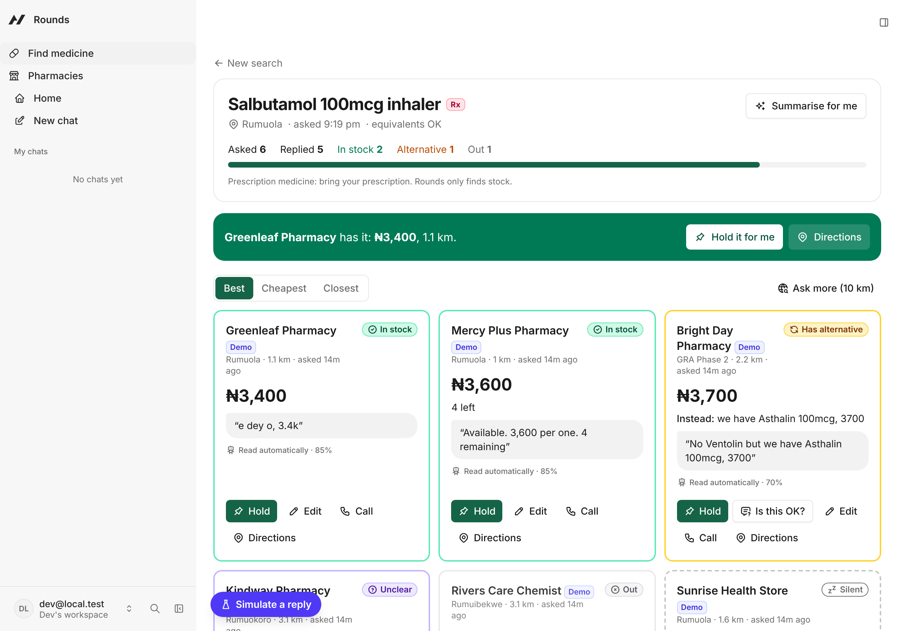
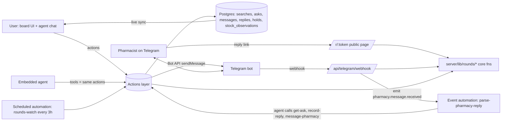

# Rounds

**We do the pharmacy rounds so you don't have to.**

Rounds is an agent-native app (built on [Agent-Native](https://www.agent-native.com)) for the Builder.io Agent-Native Hackathon. It finds which nearby pharmacy in Port Harcourt or Uyo, Nigeria has the medicine you need, by asking every pharmacist at once on Telegram and reading their replies, Pidgin included.


<!-- Screenshot/GIF placeholder: replace docs/board.png with a capture of /s/:id filling in. -->

## The problem

In Nigeria, when a doctor prescribes something you walk from pharmacy to pharmacy asking "do you have X?". It costs hours, transport money and stress, and sometimes it's urgent: an inhaler, insulin, an antimalarial for a child. "Find a drug" apps fail because **pharmacies don't publish live stock**, so there's nothing to search.

## The insight

Don't search a database that doesn't exist. Do what a person does, but all at once:

1. You say "I need a Ventolin inhaler, I'm around Rumuola".
2. The agent confirms the exact medicine (salbutamol 100mcg inhaler; Rx needed; equivalents OK?) and picks the nearest reachable pharmacies, boosting ones that had it recently.
3. It **messages every pharmacist simultaneously on Telegram**. They answer however they like: a button tap, "yes 3500", "we get am, 3.5k", "e don finish, maybe Thursday".
4. The agent **reads those messy replies** and turns them into a **live board** you can sort, correct and act on: in stock ₦3,500 / out (back Thursday) / has an alternative / unclear.
5. Tap **Hold it for me** and the agent asks that pharmacy to set one aside. They tap ✅ and the card shows 📌 *Held for Ada until 6:00 PM*.

Every reply is also stored as a dated stock observation, so Rounds slowly builds the stock map that doesn't exist today: *"Greenleaf had it 2 days ago at ₦3,400."*

## Why it's agent-native

- **The agent's users include people who never open the app.** Pharmacists work entirely in Telegram (or a 3 KB reply-link page).
- **One `record-reply` action does the core job for three callers**: the agent (reading free text through an event automation), the user (correcting a card on the board) and the pharmacist (button taps and the reply link), all through the same `recordReplyCore`.
- **The board and the chat share state.** Starting a search from chat navigates the UI to the board. Clicking a card sets the agent's `selection`, so "hold this one for Ada till 6" just works. `view-screen` hands the agent a live snapshot of the board, so "which is cheapest?" is answered from the same data you see.
- **UI buttons hand judgement calls to the agent** (`sendToAgentChat`): "Is this alternative OK?", "Summarise for me", "Ask Rounds what else to try".
- **Automations do background work**: an event automation reads each pharmacist message; a scheduled one re-asks out-of-stock pharmacies every 3 hours in watch mode.

## Architecture



All business logic lives in `server/lib/rounds/*.ts` as plain functions that take an explicit owner. Actions are thin wrappers. Public routes (Telegram webhook, reply link) resolve the owner from the ask, then call the **same** core functions, so validation and behaviour are identical for the UI, the agent and pharmacists.

## Actions

| Action | Called by | Purpose |
|---|---|---|
| `resolve-drug` | agent, UI typeahead | Match "ventolin" → salbutamol 100mcg inhaler (Rx, controlled flags) |
| `list-areas` | UI, agent | Neighbourhoods in Port Harcourt and Uyo |
| `find-pharmacies` | agent, UI confirm step | Nearest reachable pharmacies, boosted by stock memory |
| `start-search` | agent, UI | Ask pharmacies at once; agent call opens the board |
| `ask-more-pharmacies` | agent, UI "Widen" | Add pharmacies to a search |
| `get-search` | UI board, agent | Live board: statuses, prices, raw words, holds, ranking |
| `list-searches` / `update-search` | UI, agent, automation | Recent searches; done/cancel/watch |
| `get-ask` | agent, automation | One pharmacy's thread + what we asked |
| **`record-reply`** | **agent, user (Edit), pharmacist (buttons/link via core)** | **Record stock status; one path for everyone** |
| `message-pharmacy` | agent | One clarifying question to a pharmacist |
| `nudge-pharmacy` | UI, agent | Reminder to a silent pharmacy |
| `request-hold` / `cancel-hold` | agent, UI | Ask a pharmacy to set it aside (first name only) |
| `view-screen` | agent | Navigation + selected card + board snapshot |
| `list-watched-searches` / `re-ask-out-of-stock` | watch automation | Watch mode |
| `list-pharmacies` / `upsert-pharmacy` / `get-pharmacy-connect-link` | UI | Directory, connect link + QR |
| `simulate-pharmacy-reply` | dev panel | Inject a message through the real inbound pipeline (demo mode) |
| `install-rounds-automations`, `seed-demo-data`, `reset-demo` | app shell, CLI | Setup and demo housekeeping |

## How replies are read

1. Every pharmacist message (Telegram free text or a demo pharmacy) is stored unprocessed and emits `pharmacy.message.received` for the search owner.
2. The owner's event automation (`jobs/parse-pharmacy-reply.md`) runs the agent: `get-ask` → read the thread → `record-reply` (source `agent`, with confidence), or one clarifying `message-pharmacy` if it's unclear. The card shows the pharmacist's raw words and "Read by Rounds AI · 92%".
3. **Fallback:** a deterministic parser (`server/lib/rounds/parse-reply.ts`, 38 tests incl. Pidgin and "3k5"-style prices) reads any message still unprocessed after 60 seconds, so no card is stuck on "Reading…". Set `REPLY_PARSER=rules` to use it for everything.
4. Button taps, the price/restock/alternative follow-ups and the reply-link form are structured, so they're recorded directly with no LLM.

## Safety and privacy

- No medical advice: no dosing, diagnosis or switching advice. "Equivalent" means the same active ingredient, strength and form, always with "confirm with your pharmacist".
- Prescription medicines show an **Rx** badge; Rounds only locates stock.
- Controlled or abuse-prone medicines (e.g. tramadol, codeine syrup) are refused kindly, in chat and in the UI.
- Emergencies: the agent points to the nearest hospital or 112 first; every page has an emergency footer.
- Pharmacists see only the medicine and the area name, plus a first name for a hold the user asked for. The reply page shows no customer data.
- Webhook secret check, `update_id` dedupe, chat-id check on button taps, 192-bit reply tokens that expire after 48 h with a 10-submission cap, Zod on every input, owner-scoped queries (Agent-Native Doctor passes), secrets only in env, HTML escaping everywhere.

## Run locally

Requires Node 22.22+ and pnpm.

```bash
pnpm install
cp .env.example .env    # add ANTHROPIC_API_KEY; DATABASE_URL=pglite:./data/pglite
pnpm dev                # or: pnpm exec agent-native dev --host 127.0.0.1
```

Open the app, sign in (locally: "Continue as local dev"), go to **Find medicine**, search "Ventolin" near Rumuola. Demo pharmacies reply within about 45 seconds. Reference data seeds itself on first boot (`pnpm action seed-demo-data` to refresh).

Tests and checks:

```bash
pnpm test         # parser, matching, ranking
pnpm typecheck
pnpm guards       # Agent-Native Doctor
```

### Telegram

1. Create a bot with @BotFather; set `ROUNDS_TELEGRAM_BOT_TOKEN`, `ROUNDS_TELEGRAM_BOT_USERNAME`, and a 32+ character `ROUNDS_TELEGRAM_WEBHOOK_SECRET`.
2. Expose the app over HTTPS (`cloudflared tunnel --url http://localhost:8080`) and set `PUBLIC_BASE_URL`.
3. `pnpm telegram:webhook` registers the webhook and prints `getWebhookInfo`.
4. On **Pharmacies**, copy a pharmacy's connect link or show its QR; the pharmacist taps Start once.

## Environment variables

See `.env.example`. `ANTHROPIC_API_KEY`, `DATABASE_URL`, `BETTER_AUTH_SECRET` (production), `PUBLIC_BASE_URL`, `ROUNDS_TELEGRAM_BOT_TOKEN`, `ROUNDS_TELEGRAM_BOT_USERNAME`, `ROUNDS_TELEGRAM_WEBHOOK_SECRET`, `DEMO_MODE`, `REPLY_PARSER`.

## Deploy

Use a long-running Node host (Render, Railway or Fly.io) plus hosted Postgres (Neon). Live sync, demo-pharmacy timers and the watch-mode scheduler need a process that stays up; don't use Lambda or a sleeping free tier. `render.yaml` is a ready blueprint:

```bash
pnpm migrate:production   # with DATABASE_URL set to the Neon URL
```

Then set the env vars on the host, deploy, and run `pnpm telegram:webhook` against the production URL.

## Demo credentials

Judges can sign up with any email on the public demo link. Demo pharmacies (marked **Demo**) reply automatically, so the full flow works without Telegram.

<!-- Add the public URL and any shared demo account here after deploying. -->

## Limitations

- Pharmacies must connect once (a Telegram bot can't message someone who hasn't pressed Start).
- Demo pharmacies are virtual; all pharmacy names, addresses and phone numbers are fictional.
- The drug list is a demo catalog, not a medical reference.
- English UI only (the agent understands Pidgin replies).
